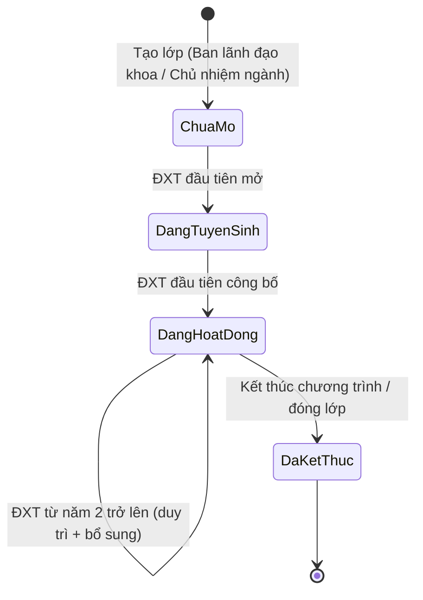
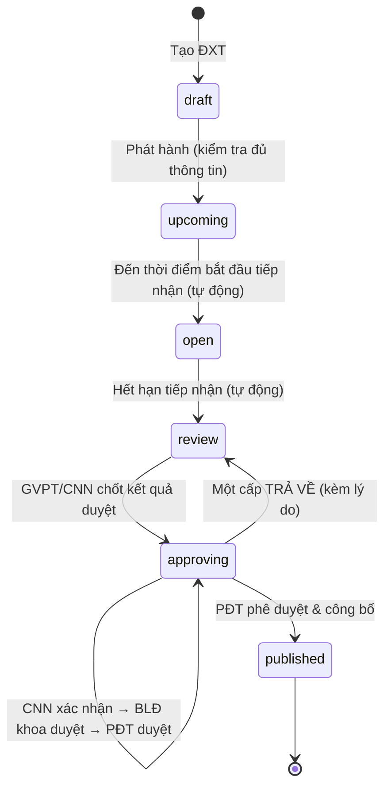
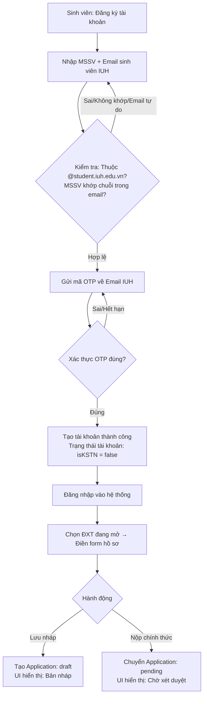
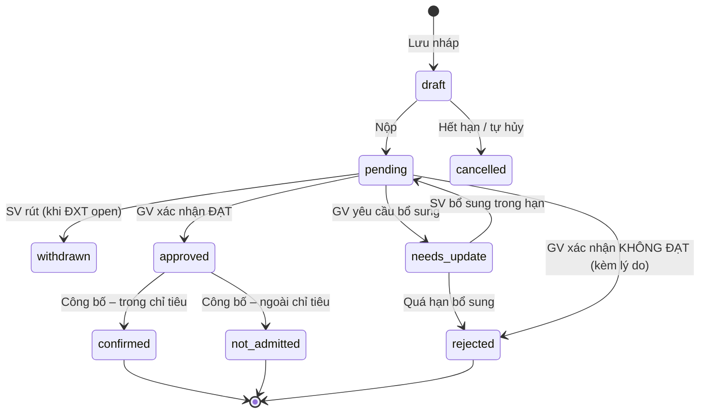
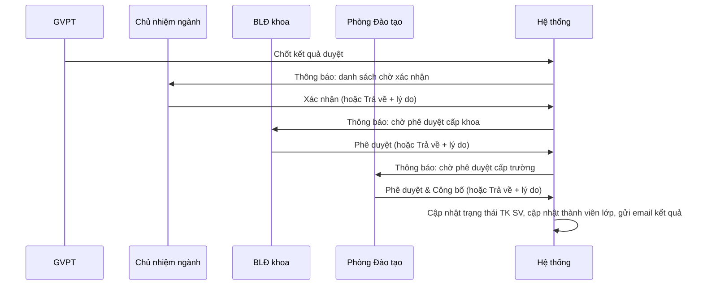
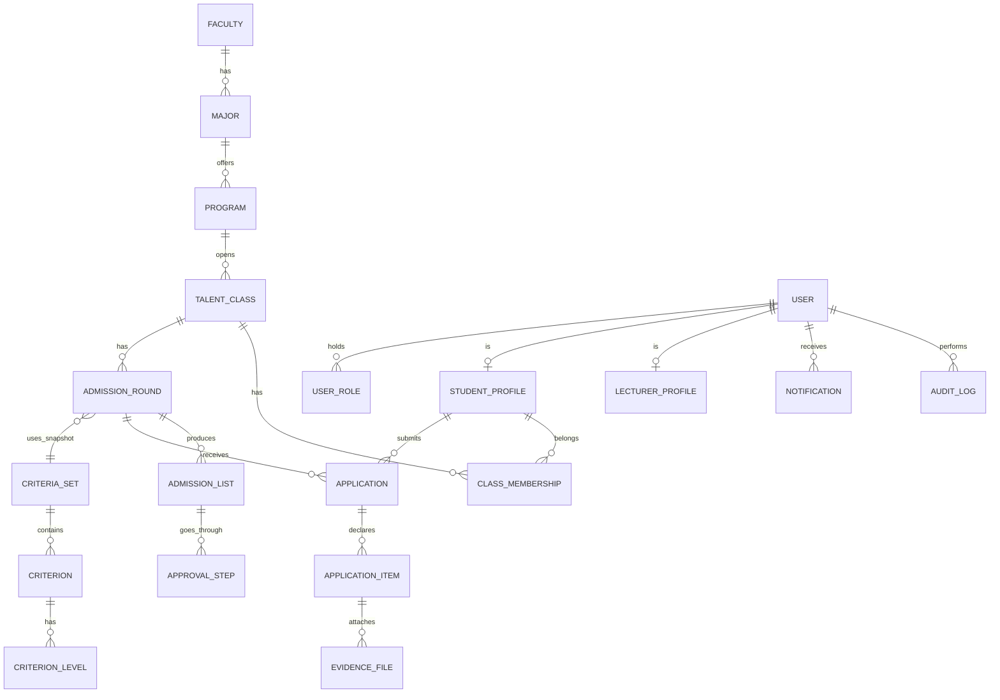

# Web KSNT – Kế hoạch thiết kế & nghiệp vụ hoàn chỉnh

**Hệ thống quản lý và xét tuyển lớp Kỹ sư tài năng / Cử nhân tài năng (KSTN/CNTN) – Trường Đại học Công nghiệp TP.HCM (IUH)**

| Mục               | Nội dung                                                                                                                   |
| ----------------- | -------------------------------------------------------------------------------------------------------------------------- |
| Tài liệu nguồn    | `Actor - Permission`, `Main Flow`, `Assessment Sample` (bản .md trong cùng thư mục)                                        |
| Hiện trạng code   | `Code/web-kstn-iuh`: React 19 + Vite 8 + Tailwind 4, dữ liệu demo (`DemoStoreProvider`), **chưa có backend**               |
| Mục đích tài liệu | Chuẩn hoá nghiệp vụ, chỉ ra chỗ mâu thuẫn/thiếu, đề xuất thiết kế dữ liệu – kiến trúc – lộ trình để nhóm xây dựng hệ thống |
| Quy ước           | 🟢 = giữ nguyên theo đặc tả của nhóm · 🟡 = đề xuất bổ sung/làm rõ · 🔴 = mâu thuẫn cần chốt trước khi code                |

---

## Mục lục

1. [Tổng quan & phạm vi](#1-tổng-quan--phạm-vi)
2. [Thuật ngữ](#2-thuật-ngữ)
3. [Đánh giá đặc tả hiện tại](#3-đánh-giá-đặc-tả-hiện-tại)
4. [Mô hình tổ chức & phân quyền](#4-mô-hình-tổ-chức--phân-quyền)
5. [Nghiệp vụ chi tiết](#5-nghiệp-vụ-chi-tiết)
6. [Bộ quy tắc nghiệp vụ (Business Rules)](#6-bộ-quy-tắc-nghiệp-vụ-business-rules)
7. [Thiết kế dữ liệu](#7-thiết-kế-dữ-liệu)
8. [Kiến trúc & công nghệ](#8-kiến-trúc--công-nghệ)
9. [Thiết kế API](#9-thiết-kế-api)
10. [Thiết kế màn hình theo vai trò](#10-thiết-kế-màn-hình-theo-vai-trò)
11. [Yêu cầu phi chức năng](#11-yêu-cầu-phi-chức-năng)
12. [Lộ trình triển khai](#12-lộ-trình-triển-khai)
13. [Kiểm thử & nghiệm thu](#13-kiểm-thử--nghiệm-thu)
14. [Rủi ro & phương án](#14-rủi-ro--phương-án)
15. [Câu hỏi cần chốt với Khoa/Phòng Đào tạo](#15-câu-hỏi-cần-chốt-với-khoaphòng-đào-tạo)

---

## 1. Tổng quan & phạm vi

### 1.1 Bài toán

Mỗi năm học, IUH mở các lớp KSTN/CNTN theo ngành. Sinh viên được tuyển vào lớp qua **đợt xét tuyển (ĐXT)** dựa trên **bộ tiêu chí** (GPA, tín chỉ, điểm rèn luyện, ngoại ngữ, thành tích…). Sinh viên đang học phải **duy trì** điều kiện mỗi năm bằng cách cập nhật **hồ sơ tích lũy**; lớp từ năm 2 trở lên có thể **tuyển bổ sung** sinh viên mới. Danh sách trúng tuyển đi qua chuỗi phê duyệt Giảng viên → Chủ nhiệm ngành → Ban lãnh đạo khoa → Phòng Đào tạo.

Hiện quy trình này chạy thủ công (form, email, Excel). Hệ thống cần số hoá toàn bộ vòng đời: **mở đợt → nộp hồ sơ → chấm/duyệt → phê duyệt nhiều cấp → công bố → cấp tài khoản → duy trì các năm sau**.

### 1.2 Mục tiêu đo được

| #   | Mục tiêu                                                       | Chỉ số                                     |
| --- | -------------------------------------------------------------- | ------------------------------------------ |
| G1  | Sinh viên nộp hồ sơ online, không cần tài khoản trước          | 100% hồ sơ qua hệ thống                    |
| G2  | Chấm điểm tự động theo bộ tiêu chí, GV chỉ xác minh minh chứng | Giảm ≥ 50% thời gian duyệt so với thủ công |
| G3  | Phê duyệt nhiều cấp có vết (ai, khi nào, ý kiến gì)            | 100% quyết định có audit log               |
| G4  | Theo dõi sinh viên KSTN xuyên suốt quá trình đào tạo           | Hồ sơ tích lũy từng năm trên 1 tài khoản   |
| G5  | Kết quả gửi email tự động                                      | Email gửi trong ≤ 15 phút sau khi công bố  |

### 1.3 Phạm vi

**Trong phạm vi (MVP):** xác thực & phân quyền theo phạm vi; danh mục Khoa/Ngành/Chuyên ngành/Lớp; bộ tiêu chí; ĐXT; nộp hồ sơ công khai; cập nhật hồ sơ tích lũy; xét duyệt; phê duyệt danh sách; công bố; tạo tài khoản tự động; email; thông báo trong hệ thống; nhật ký thao tác; báo cáo cơ bản.

**Ngoài phạm vi MVP (để giai đoạn sau):** tích hợp API với hệ thống đào tạo của trường; SSO với tài khoản trường; ứng dụng di động; chữ ký số trên quyết định; quản lý học tập/điểm danh trong lớp KSTN.

---

## 2. Thuật ngữ

| Thuật ngữ              | Ý nghĩa                                                                                                                                                                                                                                                       |
| ---------------------- | ------------------------------------------------------------------------------------------------------------------------------------------------------------------------------------------------------------------------------------------------------------- |
| KSTN / CNTN            | Kỹ sư tài năng / Cử nhân tài năng. Tài liệu ghi chung “CN/KSTN”, gọi chung là **chương trình tài năng**                                                                                                                                                       |
| Lớp CN/KSTN            | Một lớp tài năng của **một ngành, một khóa** (VD: KSTN-KTPM-K20). Mỗi ngành, mỗi khóa đào tạo của IUH chỉ có **tối đa 1 lớp**. Số năm đào tạo của lớp không cố định, phụ thuộc việc lớp có được mở ĐXT ở các năm tiếp theo hay không                          |
| ĐXT                    | Đợt xét tuyển, gắn với **1 lớp + 1 năm đào tạo** (ĐXT đầu tiên, rồi các ĐXT tiếp theo). Số ĐXT và thời điểm mở là linh hoạt, không bắt buộc phải có đủ các năm                                                                                                                     |
| Xét tuyển đầu vào      | Đợt xét tuyển **đầu tiên** của lớp, tức ĐXT được mở lần đầu để tuyển sinh viên vào lớp. Thời điểm mở phụ thuộc vào việc lớp có đủ điều kiện mở hay không, nên không nhất thiết trùng với năm đầu của khóa đào tạo |
| Xét tuyển bổ sung (BS) | Sinh viên được đăng ký hồ sơ xét tuyển vào lớp tài năng ở các ĐXT sau ĐXT đầu tiên, khi lớp mở đợt xét tuyển bổ sung. Đợt này thường được mở khi lớp chưa đủ chỉ tiêu tối đa sau các ĐXT trước, hoặc khi lớp muốn mở rộng sĩ số                                                                                                                                                     |
| Duy trì                | Sinh viên đang học lớp cập nhật hồ sơ tích lũy ở ĐXT năm kế tiếp để được ở lại lớp                                                                                                                                                                            |
| Bộ tiêu chí            | Gồm **các tiêu chí bắt buộc (BB)** và **các tiêu chí ưu tiên (UT)**. Mỗi tiêu chí tính điểm theo một trong ba cách: (1) **ngưỡng**: SV khai một con số (VD: GPA 3.5). Hệ thống so con số đó với các mức và lấy mức cao nhất mà con số đạt được (VD: GPA ≥ 3.6 → 50 điểm, ≥ 3.4 → 40 điểm); (2) **đếm**: đạt khi đủ số lượng minh chứng; (3) **tích lũy có quy đổi**: mỗi thành tích được quy đổi thành điểm theo mức đạt, các thành tích được cộng dồn trực tiếp toàn bộ (không áp trần điểm và không giới hạn số lượng tối đa) |
| Tiêu chí Bắt buộc (BB) | Điều kiện bắt buộc phải đạt. Không đạt thì hồ sơ **không đủ điều kiện**, dù tổng điểm cao đến đâu. Đạt thì vẫn được tính điểm như các tiêu chí khác                                                                                                                                                                                |
| Tiêu chí Ưu tiên (UT)  | Không bắt buộc. Đạt thì được **cộng thêm điểm** vào tổng điểm xét tuyển                                                                                                                                                                                                                         |
| GVPT                   | Giảng viên phụ trách lớp                                                                                                                                                                                                                                      |
| CNN                    | Chủ nhiệm ngành                                                                                                                                                                                                                                               |
| BLĐ khoa               | Ban lãnh đạo khoa                                                                                                                                                                                                                                             |
| PĐT                    | Đại diện phòng đào tạo                                                                                                                                                                                                                                        |
| SV vãng lai            | Người nộp hồ sơ chưa có tài khoản (khách)                                                                                                                                                                                                                     |

---

## 3. Đánh giá đặc tả hiện tại

### 3.1 Điểm mạnh nên giữ 🟢

- Vai trò bám sát cơ cấu thật của trường: Trường → Khoa → Ngành → Lớp. Quyền **có phạm vi** (của trường / của khoa / của ngành / của lớp), là nền tảng tốt cho mô hình RBAC theo phạm vi.
- Tách rõ 3 nhóm sinh viên theo **trạng thái tài khoản** (chưa có TK / có TK nhưng năm trước không học / đang học lớp).
- ĐXT có giai đoạn với **mốc thời gian** rõ ràng.
- Bộ tiêu chí dạng **1-N** (một tiêu chí nhiều mức), có loại BB/UT và cột thứ tự xét hòa. Thiết kế này linh hoạt.
- Tài khoản sinh viên **tự động tạo** sau khi trúng tuyển, nên không có tài khoản rác.
- Một email + một số điện thoại cho mỗi tài khoản, người dùng tự sửa sau khi đăng nhập.

### 3.2 Mâu thuẫn & thiếu sót cần xử lý

| Mã     | Vị trí                           | Vấn đề                                                                                                                                                                                                                                     | Đề xuất                                                                                                                                                                                |
| ------ | -------------------------------- | ------------------------------------------------------------------------------------------------------------------------------------------------------------------------------------------------------------------------------------------ | -------------------------------------------------------------------------------------------------------------------------------------------------------------------------------------- |
| 🟢 C1  | Main Flow – Luồng 3, TH1, Bước 2 | Mục “Cập nhật hồ sơ xét tuyển” chỉ hiện khi ĐXT ở giai đoạn **“Đang xét duyệt hồ sơ”**. Nhưng mục “Diễn ra ĐXT – Luồng 2” lại nói SV cũ cập nhật hồ sơ tích lũy ở giai đoạn **“Tiếp nhận hồ sơ”** và giai đoạn xét duyệt thì **đóng cổng** | **ĐÃ CHỐT:** Sửa thành **“Tiếp nhận hồ sơ”**. Mục chỉ hiển thị và cho phép nộp ở giai đoạn này. Ở giai đoạn xét duyệt cổng tiếp nhận đóng, chỉ cho sửa khi GV gửi **yêu cầu bổ sung** (xem 5.5) |
| 🟢 C2  | Actor-Permission ↔ Main Flow     | Actor có chuỗi **CNN xác nhận → BLĐ khoa phê duyệt → PĐT phê duyệt** danh sách trúng tuyển, nhưng Main Flow đi thẳng từ “Đang xét duyệt” sang “Đã kết thúc/Công bố”                                                                        | **ĐÃ CHỐT:** Thêm trạng thái **“Chờ phê duyệt”** với 3 bước con giữa xét duyệt và công bố. **Chỉ khi PĐT phê duyệt cấp cuối** thì ĐXT mới chính thức kết thúc và công bố danh sách trúng tuyển (xem 5.6). |
| 🟢 C3  | Main Flow – Đăng ký tài khoản    | “Nếu được duyệt thành công thì tự tạo TK và gửi kết quả”. Nhưng GV duyệt hồ sơ **chưa phải** kết quả cuối, vì danh sách còn phải qua 3 cấp phê duyệt và có thể vượt chỉ tiêu | **ĐÃ CHỐT:** Sinh viên tự đăng ký tài khoản (xác thực OTP qua email sinh viên IUH) với trạng thái mặc định **`isKSTN = false`**. Toàn bộ tiến trình nộp hồ sơ được quản lý sạch sẽ ở bảng `Application` (`draft`, `pending`, `needs_update`, `approved`, `confirmed`, `rejected`, `not_admitted`). Khi GV duyệt, nếu đạt BB nhưng lỗi format/minh chứng thì gửi yêu cầu bổ sung (`needs_update`). Chỉ khi PĐT công bố kết quả, hồ sơ trúng tuyển mới tự động kích hoạt **`isKSTN = true`** (xem 5.4, 5.5, 5.7). |
| 🟢 C4  | Main Flow – Luồng 1/2 Nộp hồ sơ  | Nhập MSSV là hệ thống cho nộp hồ sơ, **không xác minh danh tính**. Ai cũng có thể nộp thay hoặc mạo danh, và có thể dò MSSV nào đã có tài khoản | **ĐÃ CHỐT:** Bắt buộc đăng ký tài khoản bằng **email sinh viên trường IUH** (chặn email tự do ngoài trường). Hệ thống **tự động đối chiếu chéo chuỗi MSSV trong email với MSSV nhập**, gửi mã OTP về email sinh viên để đảm bảo 100% chính chủ và chống mạo danh (xem 5.4). |
| 🟢 C5  | Main Flow – Tạo ĐXT Luồng 2      | Trường “Giảng viên phụ trách” và “GVPT” bị lặp                                                                                                                                                                                             | **ĐÃ CHỐT:** Lược bỏ trường “GVPT” trùng lặp.                                                                                                                                          |
| 🟢 C6  | Main Flow – Tạo ĐXT              | Thiếu **chỉ tiêu** (sĩ số tối đa) và thông tin thời gian mở đợt                                                                                                                                                                             | **ĐÃ CHỐT:** Bổ sung **Sĩ số tối đa (`quota`)**, **Học kỳ (`semester`)** và **Năm học (`academicYear`)**. Vì việc chấp thuận mở lớp KSTN ở các năm rất linh hoạt, thông tin học kỳ và năm học giúp sinh viên nắm rõ trong năm học đó những chuyên ngành/lớp tài năng nào được phép mở xét tuyển (xem 5.2). |
| 🟢 C7  | Main Flow – Luồng 1              | Luồng 1 gọi là “xét tuyển năm 1” nhưng thực chất phân loại theo **trạng thái tài khoản**. SV năm 2 chưa từng có TK (VD đã trượt năm 1) cũng đi luồng này | **ĐÃ CHỐT:** Thống nhất phân loại 3 luồng đồng nhất theo C3/C4: **Luồng A** (Chưa có TK - tự đăng ký mới qua Email sinh viên IUH), **Luồng B** (Có TK, `isKSTN = false` - nộp bổ sung), **Luồng C** (Có TK, `isKSTN = true` - cập nhật duy trì) (xem 5.4). |
| 🟢 C8  | Main Flow – Luồng 2              | “SV đã có TK nhưng năm trước không học lớp KSTN”. TK chỉ được tạo khi trúng tuyển, nên nhóm này thực chất là **SV từng học rồi bị loại / tự rút** | **ĐÃ CHỐT:** Định nghĩa rõ ràng bao gồm: SV từng nộp trượt đợt trước, SV từng học KSTN nhưng bị loại/tự rút, SV đã tạo TK nhưng chưa nộp. Chốt câu hỏi Q3: Nhóm này **được phép nộp lại bình thường** ở các ĐXT bổ sung tiếp theo mà không bị hạn chế thời gian, hệ thống tự động kế thừa thông tin cũ (xem 5.4, Q3). |
| 🟢 C9  | Ghi chú đỏ – Assessment          | Tiêu chí vừa **quy đổi** (giải Nhất/Nhì/Ba) vừa **tích lũy** (nhiều thành tích) chưa có cách xử lý                                                                                                                                         | **ĐÃ CHỐT:** Bổ sung kiểu tiêu chí **“Tích lũy có quy đổi” (`ACCUMULATIVE_ENUM`)**: mỗi minh chứng chọn 1 mức giải, điểm = tổng điểm cộng dồn của tất cả các giải hợp lệ (**bỏ điểm trần và không giới hạn số lượng tối đa** để ghi nhận toàn bộ thành tích, có ví dụ chi tiết tại 5.3.4). |
| 🟢 C10 | Ghi chú đỏ – Main Flow           | “Tương lai có thể yêu cầu cạnh tranh sòng phẳng trong lớp mở năm tiếp theo không?”                                                                                                                                                         | **ĐÃ CHỐT:** Đưa vào cấu hình ĐXT **chế độ xếp hạng (`rankingMode`)**: `MAINTAIN_THEN_FILL` (mặc định) hoặc `OPEN_COMPETITION` (cạnh tranh sòng phẳng). Đổi cách xét không cần sửa code (xem 5.8). |
| 🟢 C11 | Actor – GVPT                     | “Đặt lại mật khẩu cho tài khoản sinh viên **của ngành**”, trong khi các quyền khác của GVPT đều ở phạm vi **lớp**                                                                                                                          | **ĐÃ CHỐT:** Thu hẹp quyền đặt lại mật khẩu về **SV của lớp mình phụ trách** (phạm vi `CLASS`), đúng theo mô hình RBAC theo phạm vi. |
| 🟢 C12 | Actor – CNN & GVPT               | Cả hai đều “Quản lý bộ tiêu chí xét tuyển **của khoa**”. Cần cơ chế phân quyền chia sẻ và thao tác rõ ràng | **ĐÃ CHỐT:** Bộ tiêu chí được dùng **công khai trong phạm vi Khoa**, mọi GV đều có thể xem và chọn bất kỳ bộ tiêu chí nào có sẵn để gắn vào ĐXT ngành/lớp mình đảm nhận. Phân quyền CRUD: **GVPT** tạo mới và chỉ được sửa/xóa (Update/Delete) bộ tiêu chí do chính mình tạo (Owner); **CNN** toàn quyền CRUD bộ tiêu chí thuộc phạm vi ngành mình; **BLĐ Khoa** toàn quyền CRUD tất cả bộ tiêu chí trong toàn Khoa (xem 4.3, 5.3). |
| 🟢 C13 | Actor – Quản trị viên ↔ PĐT      | Quản trị viên và PĐT trùng nhiều quyền ở phạm vi trường (chuyên ngành, TK GV, phân quyền)                                                                                                                                                  | **ĐÃ CHỐT:** Phân định rõ trách nhiệm: Quản trị viên phụ trách **kỹ thuật & vận hành hệ thống** (cấu hình, danh mục kỹ thuật, audit log, khôi phục sự cố); PĐT phụ trách **nghiệp vụ đào tạo** (tra cứu, thẩm định, phê duyệt cuối & công bố, xem báo cáo). |
| 🟢 C14 | Actor – SV vãng lai              | Không có cách **tra cứu trạng thái / sửa / rút** hồ sơ đã nộp                                                                                                                                                                              | **ĐÃ CHỐT (Đồng bộ theo C3, C4):** Không còn đối tượng "vãng lai" khi nộp hồ sơ. Sinh viên tự tạo tài khoản (xác thực email IUH + OTP) ngay từ đầu. Sinh viên **đăng nhập vào tài khoản của mình để trực tiếp theo dõi, chỉnh sửa hoặc rút hồ sơ** khi ĐXT còn mở tiếp nhận. |
| 🟢 C15 | Toàn bộ                          | Chưa nói về: **quy định file minh chứng**, **nhật ký thao tác**, **thông báo cho GV/CNN**, **báo cáo thống kê**, **trường hợp SV nộp nhiều đợt cùng lúc**                                                                                  | **ĐÃ CHỐT:** (1) **File minh chứng:** Yêu cầu định dạng, số lượng, nội dung minh chứng được **giảng viên trực tiếp mô tả trong từng tiêu chí** của bộ tiêu chí (hệ thống hỗ trợ chuẩn file PDF/PNG/JPG, tối đa 10MB/file); (2) **Nhật ký thao tác (Audit log):** Quản trị viên/PĐT tra cứu toàn bộ log thay đổi điểm, duyệt hồ sơ, phê duyệt ĐXT; (3) **Thông báo:** Gửi in-app và email khi có hồ sơ cần duyệt, khi ĐXT chuyển bước phê duyệt hoặc trả về; (4) **Báo cáo thống kê:** PĐT/BLĐ Khoa xuất báo cáo kết quả trúng tuyển, phổ điểm (Excel/PDF); (5) **Nộp nhiều đợt:** SV được nộp nhiều ĐXT cùng lúc nhưng khi trúng tuyển chỉ được xác nhận (`confirmed`) học 1 lớp duy nhất (xem 5.4, 5.10, BR-08, Q4). |
| 🟢 C16 | Assessment                       | Bộ tiêu chí **khác nhau theo năm đào tạo** (năm 2 Tiếng Anh ≥ 450 là BB, năm 3 ≥ 550 và Bài báo/giải thưởng là BB). Cần xác định có ràng buộc cứng bộ tiêu chí theo năm hay không | **ĐÃ CHỐT:** **Không gán cứng ràng buộc kỹ thuật** theo năm đào tạo (`studyYear`). Việc tạo và sử dụng bộ tiêu chí được thiết kế linh hoạt trong phạm vi Khoa theo luồng C3, C4 và C12: Giảng viên/Khoa chủ động lựa chọn và áp dụng bộ tiêu chí phù hợp nhất với mục tiêu tuyển chọn thực tế của từng ĐXT mà không bị bó buộc bởi quy định cứng. |
| 🟢 C17 | Code demo                        | `ROUND_STATUSES` có `upcoming` (Chưa mở) nhưng đặc tả ban đầu chỉ có 3 trạng thái | **ĐÃ CHỐT:** Đồng bộ và chuẩn hóa vòng đời ĐXT theo quy trình xét duyệt mới (C1, C2, C3, C4): gồm 6 trạng thái nghiệp vụ chuẩn xác: `draft` (Bản nháp) $\rightarrow$ `upcoming` (Sắp diễn ra) $\rightarrow$ `open` (Tiếp nhận hồ sơ) $\rightarrow$ `review` (Đang xét duyệt) $\rightarrow$ `approving` (Chờ phê duyệt 3 cấp) $\rightarrow$ `published` (Đã công bố / kết thúc) (xem 5.2). Code demo sẽ được cập nhật đồng bộ theo danh sách chuẩn này. |

---

## 4. Mô hình tổ chức & phân quyền

### 4.1 Cây tổ chức

```
Trường (IUH)
└── Khoa (VD: Khoa CNTT)
    └── Ngành (VD: Kỹ thuật phần mềm)
        └── Lớp CN/KSTN theo khóa (VD: KSTN-KTPM-K20)
            └── ĐXT đầu tiên, các ĐXT tiếp theo (số lượng không cố định)
```

### 4.2 Mô hình phân quyền: RBAC + phạm vi

Một **tài khoản** có thể giữ **nhiều vai trò**, mỗi vai trò gắn với **một phạm vi**. Ví dụ: TS. Trần Ngọc Bình vừa là Chủ nhiệm ngành của ngành KTPM, vừa là Giảng viên phụ trách của lớp KSTN-KTPM-K22.

```
UserRoleAssignment = (userId, role, scopeType, scopeId, validFrom, validTo)
scopeType ∈ { SCHOOL, FACULTY, MAJOR, CLASS, SELF }
```

**Kiểm tra quyền** = có `permission` **và** đối tượng thao tác nằm trong phạm vi được gán. Phạm vi cha bao phạm vi con: SCHOOL ⊃ FACULTY ⊃ MAJOR ⊃ CLASS.

Khi người dùng có nhiều vai trò: giao diện có **bộ chọn vai trò** (giống `roles` trong `fixtures.js` hiện tại). Mỗi phiên làm việc dùng một vai trò để giao diện gọn và tránh nhầm phạm vi.

| Vai trò (tên gốc theo đặc tả)                  | Phạm vi (scopeType) |
| ---------------------------------------------- | ------------------- |
| Quản trị viên                                  | SCHOOL              |
| Đại diện phòng đào tạo                         | SCHOOL              |
| Ban lãnh đạo khoa                              | FACULTY             |
| Chủ nhiệm ngành                                | MAJOR               |
| Giảng viên phụ trách                           | CLASS               |
| Sinh viên CN/KSTN (đã được duyệt tài khoản)    | SELF                |
| Sinh viên vãng lai (chưa được duyệt tài khoản) | —                   |

### 4.3 Ma trận quyền (đã chuẩn hoá)

Ký hiệu: **T** = toàn trường · **K** = của khoa · **N** = của ngành · **L** = của lớp · **S** = của bản thân · **V** = chỉ xem · — = không có

| Chức năng                                     | Quản trị viên (Kỹ thuật) | Đại diện phòng đào tạo (Nghiệp vụ) | Ban lãnh đạo khoa | Chủ nhiệm ngành | Giảng viên phụ trách             | Sinh viên KSTN (`isKSTN=true`) | Sinh viên ứng viên (`isKSTN=false`) |
| --------------------------------------------- | ------------------------ | ---------------------------------- | ----------------- | --------------- | -------------------------------- | ------------------------------ | ----------------------------------- |
| Đăng nhập / Đăng xuất / Đổi MK / Khôi phục MK | ✔                        | ✔                                  | ✔                 | ✔               | ✔                                | ✔                              | ✔                                   |
| Xem & sửa thông tin cá nhân (email, SĐT)      | S                        | S                                  | S                 | S               | S                                | S                              | S                                   |
| Đặt lại MK mặc định cho GV                    | T                        | T                                  | K                 | N               | —                                | —                              | —                                   |
| Đặt lại MK mặc định cho SV                    | T                        | T                                  | K                 | N               | L 🟢(C11)                        | —                              | —                                   |
| Quản lý danh mục Khoa / Ngành                 | T                        | V                                  | V                 | V               | —                                | —                              | —                                   |
| Quản lý chuyên ngành CN/KSTN                  | T                        | T                                  | K                 | V               | —                                | —                              | —                                   |
| Quản lý tài khoản giảng viên                  | T                        | T (tra cứu)                        | K                 | N               | —                                | —                              | —                                   |
| Phân quyền tài khoản giảng viên               | T                        | T                                  | K                 | N               | —                                | —                              | —                                   |
| Quản lý tài khoản sinh viên                   | T                        | T (tra cứu)                        | V                 | V               | V                                | —                              | —                                   |
| Quản lý lớp CN/KSTN                           | T                        | V                                  | K                 | N               | L (lớp mình phụ trách)           | —                              | —                                   |
| Quản lý bộ tiêu chí                           | T                        | V                                  | K (CRUD toàn khoa) | N (CRUD ngành, dùng toàn khoa) | K (dùng chung) / Owner (CRUD) 🟢(C12) | —                              | —                                   |
| Quản lý ĐXT                                   | T                        | V                                  | K                 | N               | L (sửa mốc thời gian, không tạo) | —                              | —                                   |
| Xem thông tin ĐXT công khai                   | ✔                        | ✔                                  | ✔                 | ✔               | ✔                                | ✔                              | ✔                                   |
| Nộp hồ sơ xét tuyển mới / bổ sung             | —                        | —                                  | —                 | —               | —                                | —                              | S (Luồng A/B)                       |
| Cập nhật hồ sơ tích lũy (duy trì)             | —                        | —                                  | —                 | —               | —                                | S (Luồng C)                    | —                                   |
| Rút / Chỉnh sửa hồ sơ đã nộp (khi ĐXT mở)     | —                        | —                                  | —                 | —               | —                                | S                              | S 🟢(C14)                           |
| Xem hồ sơ SV CN/KSTN                          | T                        | T                                  | K                 | N               | L                                | S                              | S                                   |
| Duyệt từng hồ sơ (Đạt / Không đạt / Bổ sung)  | —                        | —                                  | —                 | N               | L                                | —                              | —                                   |
| Xác nhận danh sách trúng tuyển                | —                        | —                                  | —                 | N               | —                                | —                              | —                                   |
| Phê duyệt danh sách trúng tuyển               | —                        | T (cấp cuối)                       | K                 | —               | —                                | —                              | —                                   |
| Công bố kết quả                               | —                        | T                                  | —                 | —               | —                                | —                              | —                                   |
| Xem thông báo                                 | ✔                        | ✔                                  | ✔                 | ✔               | ✔                                | ✔                              | ✔                                   |
| Báo cáo / thống kê                            | T                        | T                                  | K                 | N               | L                                | —                              | —                                   |
| Cấu hình kỹ thuật hệ thống (SMTP, files)      | T                        | —                                  | —                 | —               | —                                | —                              | —                                   |
| Nhật ký thao tác (audit)                      | T                        | T (V)                              | —                 | —               | —                                | —                              | —                                   |

> Ghi chú: “Công bố” đặt ở PĐT vì đây là cấp phê duyệt cuối. Nếu nhà trường muốn khoa tự công bố sau khi PĐT duyệt thì đổi ở cấu hình, không cần sửa code (Q5).

---

## 5. Nghiệp vụ chi tiết

### 5.1 Vòng đời lớp CN/KSTN



**Thông tin lớp:** mã lớp, tên, chuyên ngành, khóa (K20…), năm bắt đầu, GVPT hiện tại, sĩ số, trạng thái.

**Thành viên lớp** (`ClassMembership`) lưu theo **từng năm đào tạo**: `ACTIVE` (đang học), `DROPPED` (không đạt duy trì), `WITHDRAWN` (tự rút), `GRADUATED`. Nhờ đó trả lời được câu hỏi “năm trước SV có học lớp KSTN không”, là điều kiện phân luồng ở 5.4.

### 5.2 Vòng đời ĐXT (state machine)



| Trạng thái (code) | Nhãn hiển thị            | Ai làm gì                                                                                  |
| ----------------- | ------------------------ | ------------------------------------------------------------------------------------------ |
| `draft`           | Nháp                     | Người tạo sửa tự do. Chưa công khai                                                        |
| `upcoming`        | Chưa mở                  | Đã công khai trên trang chủ, chưa nhận hồ sơ. Vẫn sửa được mốc thời gian                   |
| `open`            | Đang tiếp nhận hồ sơ     | SV nộp hồ sơ mới / SV cũ cập nhật hồ sơ tích lũy. **Khóa bộ tiêu chí**                     |
| `review`          | Đang xét duyệt hồ sơ     | Đóng cổng nộp. GVPT/CNN duyệt, có thể yêu cầu bổ sung                                      |
| `approving`       | Chờ phê duyệt            | Danh sách đi qua 3 cấp. Có các bước con `waiting_head`, `waiting_dean`, `waiting_training` |
| `published`       | Đã kết thúc / Đã công bố | Kết quả công khai, tạo TK, gửi email, cập nhật thành viên lớp. **Bất biến**                |

**Chuyển trạng thái tự động** chạy bằng tác vụ định kỳ (mỗi phút). Quản trị viên/Ban lãnh đạo khoa có thể **chuyển thủ công** (VD: gia hạn) và mọi lần chuyển đều ghi audit log. Múi giờ dùng `Asia/Ho_Chi_Minh`.

**Thông tin ĐXT (chuẩn hoá):**

| Trường                                      | Bắt buộc | Ghi chú                                                             |
| ------------------------------------------- | -------- | ------------------------------------------------------------------- |
| Lớp CN/KSTN                                 | ✔        | Khoa, Ngành, Khóa được **suy ra** từ lớp, không nhập lại            |
| Học kỳ (`semester`)                         | ✔        | VD: Học kỳ 1, Học kỳ 2, Học kỳ hè                                    |
| Năm học (`academicYear`)                    | ✔        | VD: 2026–2027 (giúp SV biết năm đó có những chuyên ngành KSTN nào mở tuyển) |
| Sĩ số tối đa (`quota`)                      | ✔        | Tổng số SV tối đa của lớp sau đợt xét tuyển                         |
| Bộ tiêu chí                                 | ✔        | Chỉ cho chọn bộ đã **ban hành**, cùng khoa                          |
| Giảng viên phụ trách                        | ✔        | Mặc định lấy GVPT của lớp (đã loại bỏ dòng GVPT lặp)                |
| Chế độ xếp hạng                             | ✔        | `MAINTAIN_THEN_FILL` / `OPEN_COMPETITION` (ĐXT mở đầu không áp dụng)  |
| Thời gian tiếp nhận (bắt đầu–kết thúc)      | ✔        |                                                                     |
| Thời gian xét duyệt (bắt đầu–kết thúc)      | ✔        | Bắt đầu ≥ kết thúc tiếp nhận                                        |
| Hạn phê duyệt dự kiến                       | —        | Dùng để nhắc việc                                                   |
| Mô tả / thông báo tuyển sinh, file đính kèm | —        | Hiển thị ở trang chi tiết đợt                                       |

> 💡 *Lưu ý:* Việc chấp thuận mở lớp KSTN ở các năm là rất linh hoạt (không bắt buộc cố định các năm). Do đó, thông tin **Học kỳ** và **Năm học** là cơ sở chính để sinh viên tra cứu và biết được năm đó những chuyên ngành tài năng nào được phép mở đợt tuyển sinh.

**Ràng buộc:** Mỗi lớp trong một học kỳ + năm học chỉ có **1 ĐXT không ở trạng thái `draft`**. Muốn mở lại thì phải tạo đợt mới sau khi đợt cũ đã công bố hoặc bị hủy.

### 5.3 Bộ tiêu chí & cách chấm điểm

Một bộ tiêu chí gồm nhiều tiêu chí. Mỗi tiêu chí thuộc một trong hai nhóm: **BB** (bắt buộc, phải đạt) hoặc **UT** (ưu tiên, dùng để cộng điểm). Cách tính điểm của từng tiêu chí phụ thuộc vào **kiểu** của nó (mục 5.3.2).

#### 5.3.1 Cấu trúc & Cơ chế chia sẻ, phân quyền (C12)

```
CriteriaSet (bộ tiêu chí: tên, khoa_id, major_id, created_by, status DRAFT/PUBLISHED/ARCHIVED)
└── Criterion (tiêu chí: tên, nhóm BB/UT, kiểu tính điểm, thứ tự xét hòa, có bắt buộc minh chứng không)
    └── CriterionLevel (mức đánh giá: điều kiện → điểm)
```

**Quy tắc chia sẻ và phân quyền CRUD bộ tiêu chí trong Khoa (C12):**
- **Sử dụng công khai trong phạm vi Khoa:** Toàn bộ các bộ tiêu chí được chia sẻ công khai cho tất cả giảng viên trong khoa. Bất kỳ giảng viên nào khi tạo ĐXT cho lớp/ngành mình đảm nhận đều có thể xem và chọn bất kỳ bộ tiêu chí có sẵn nào trong khoa để áp dụng.
- **Phân quyền thao tác (CRUD):**
  - **Giảng viên phụ trách (GVPT):** Được tạo mới (Create) bộ tiêu chí. Đối với thao tác Chỉnh sửa / Xóa (Update / Delete): **chỉ người tạo (Creator / Owner) mới có quyền sửa/xóa** bộ tiêu chí đó. Với bộ tiêu chí do người khác tạo, GVPT chỉ có quyền xem và sử dụng (Read & Use), tuyệt đối không được sửa/xóa của người khác.
  - **Chủ nhiệm ngành (CNN):** Toàn quyền CRUD đối với các bộ tiêu chí thuộc phạm vi ngành mình đang đảm nhận quản lý; có quyền xem và sử dụng các bộ tiêu chí khác trong khoa.
  - **Ban lãnh đạo khoa (BLĐ Khoa):** Thẩm quyền cao nhất trong khoa, có toàn quyền CRUD đối với tất cả các bộ tiêu chí trong toàn Khoa.
- **Khóa snapshot:** Khi một ĐXT chuyển sang giai đoạn `open`, bộ tiêu chí gắn vào ĐXT đó được lưu snapshot JSONB và khóa bất biến, đảm bảo việc sửa đổi bộ tiêu chí gốc sau đó không làm xáo trộn đợt xét tuyển đang diễn ra.

#### 5.3.2 Ba kiểu tiêu chí

| Kiểu (`valueType`) | Ví dụ | SV khai gì | Cách tính điểm |
| --- | --- | --- | --- |
| `NUMBER_THRESHOLD` (ngưỡng số) | GPA, số tín chỉ đạt, điểm rèn luyện, điểm Tiếng Anh | Một con số + minh chứng | Đối chiếu số đó với các mức và lấy **mức cao nhất mà số đó thỏa**. VD: GPA 3.5 thỏa "≥ 3.4" (40 điểm) nhưng không thỏa "≥ 3.6" (50 điểm) |
| `COUNT` (đếm minh chứng) | "1 thành tích NCKH" | Số lượng minh chứng + minh chứng | Đạt khi số lượng ≥ ngưỡng. Điểm là điểm của mức đạt, hoặc điểm × số lượng nếu được cấu hình theo số lượng |
| `ACCUMULATIVE_ENUM` (tích lũy có quy đổi) | Thành tích cuộc thi chuyên ngành (Nhất/Nhì/Ba/KK) | Thêm nhiều thành tích, mỗi thành tích kèm minh chứng và **mức đạt được** | Quy đổi từng thành tích thành điểm, **cộng dồn toàn bộ** các thành tích hợp lệ (không áp trần điểm và không giới hạn số lượng tối đa) (xem 5.3.4) |

#### 5.3.3 Quy tắc chấm

1. **Tiêu chí BB:** nếu hồ sơ không thỏa **bất kỳ** tiêu chí BB nào thì hồ sơ **không đủ điều kiện**, dù tổng điểm cao.
2. **Tiêu chí UT:** không thỏa thì được 0 điểm, hồ sơ vẫn hợp lệ.
3. **Tổng điểm** = tổng điểm BB + tổng điểm UT, sau khi đã áp trần của từng tiêu chí.
4. **Điểm tự khai** hệ thống tính ngay khi SV nhập, để SV biết điểm dự kiến. **Điểm chính thức** là điểm sau khi GV xác minh từng tiêu chí. GV có thể sửa giá trị nhưng phải ghi lý do.
5. **Xét hòa:** khi bằng tổng điểm, so lần lượt theo thứ tự xét hòa của các tiêu chí (VD: GPA → Tiếng Anh → Rèn luyện). Nếu vẫn bằng, đưa cả nhóm cho cấp phê duyệt quyết định và đánh dấu cảnh báo trên danh sách.
6. **Bất biến khi đang mở:** khi ĐXT đã `open`, hệ thống lưu snapshot bộ tiêu chí vào ĐXT. Sửa bộ tiêu chí sau đó sẽ tạo phiên bản mới và không ảnh hưởng đợt đang chạy.

**Ví dụ (theo bảng Assessment Sample):** SV có GPA 3.5, 40 TC đạt, 0 TC không đạt, rèn luyện 85, TOEIC 600, 1 NCKH, 2 giải cuộc thi (Nhất + Ba).

| Tiêu chí              | Loại | Giá trị   | Mức thỏa     | Điểm               |
| --------------------- | ---- | --------- | ------------ | ------------------ |
| Số TC đạt             | BB   | 40        | ≥ 38         | 5                  |
| Số TC không đạt       | BB   | 0         | = 0          | 5                  |
| GPA năm 2             | BB   | 3.5       | ≥ 3.4        | 40                 |
| Rèn luyện năm 2       | BB   | 85        | > 80         | 20                 |
| Tiếng Anh             | BB   | 600       | ≥ 450        | 20                 |
| NCKH                  | BB   | 1         | 1 thành tích | 20                 |
| Tiếng Anh             | UT   | 600       | ≥ 550        | 20                 |
| Cuộc thi chuyên ngành | UT   | Nhất + Ba | 40 + 20      | 60                 |
| **Tổng**              |      |           |              | **190**            |

> ⚠️ Bảng mẫu dùng **cùng tiêu chí Tiếng Anh cho cả BB (≥ 450) và UT (≥ 550)**. Cách hiểu hợp lý: 450 là điều kiện tối thiểu, đạt 550 thì được cộng thêm. Vì vậy nên cho phép tiêu chí UT **tham chiếu** giá trị đã khai ở BB, để SV không phải khai hai lần.

#### 5.3.4 Trả lời ghi chú đỏ: tiêu chí vừa quy đổi vừa tích lũy (`ACCUMULATIVE_ENUM`)

**Vấn đề:** SV có thể có nhiều thành tích, mỗi thành tích xếp một cấp giải khác nhau (Nhất, Nhì, Ba, Khuyến khích). Cần cơ chế ghi nhận trọn vẹn năng lực của sinh viên.

**Quy tắc nghiệp vụ đã chốt:**
- **Bỏ điểm trần và bỏ giới hạn số lượng thành tích tối đa** để khuyến khích và ghi nhận toàn bộ nỗ lực học thuật/nghiên cứu của sinh viên.
- Mỗi thành tích sinh viên khai báo sẽ chọn một mức giải quy đổi tương ứng kèm file minh chứng.
- Giảng viên xác minh từng minh chứng (duyệt Đạt hoặc Từ chối nếu minh chứng không hợp lệ).
- **Công thức tính điểm:** Điểm tiêu chí bằng tổng điểm quy đổi của tất cả các thành tích hợp lệ được duyệt:
  $$\text{Điểm tiêu chí} = \sum_{i=1}^{n} \text{Điểm quy đổi}(\text{Thành tích}_i)$$

**Ví dụ minh họa cụ thể:**
- **Bảng quy đổi mức giải:** Giải Nhất = 40đ | Giải Nhì = 30đ | Giải Ba = 20đ | Giải Khuyến khích = 10đ.
- **Sinh viên A tham gia và nộp 4 giải hợp lệ:**
  1. Cuộc thi Học thuật cấp Trường: Giải Nhất $\rightarrow$ 40 điểm
  2. Cuộc thi Lập trình Olympic: Giải Ba $\rightarrow$ 20 điểm
  3. Cuộc thi Hackathon Khoa: Giải Ba $\rightarrow$ 20 điểm
  4. Cuộc thi Ý tưởng sáng tạo: Giải Khuyến khích $\rightarrow$ 10 điểm
- $\rightarrow$ **Tổng điểm tiêu chí của SV A** = 40 + 20 + 20 + 10 = **90 điểm** (cộng dồn toàn bộ 4 giải, không bị chặn bởi điểm trần hay số lượng).

### 5.4 Nộp hồ sơ xét tuyển (luồng chuẩn hoá)



**Mô hình tài khoản & hồ sơ đơn giản hóa:**
- **Tài khoản Sinh viên (`Student`):** Chỉ lưu cờ **`isKSTN`** (True/False):
  - `isKSTN = false`: Sinh viên thông thường / Ứng viên (mặc định khi đăng ký).
  - `isKSTN = true`: Sinh viên KSTN chính thức (được kích hoạt sau khi trúng tuyển ĐXT).
  *(Lưu ý: Các trường thông tin mở rộng cho thực thể SinhVien sẽ được thiết kế bổ sung trong tương lai khi có yêu cầu).*
- **Hồ sơ xét tuyển (`Application`):** Quản lý độc lập toàn bộ vòng đời nộp/xét tuyển của sinh viên trên từng ĐXT (`draft` $\rightarrow$ `pending` $\rightarrow$ `needs_update` $\rightarrow$ `approved` $\rightarrow$ `confirmed`/`not_admitted`/`rejected`). Trạng thái nộp bài của sinh viên trên giao diện được hiển thị trực tiếp từ bảng `Application`.

**Phân loại 3 luồng nộp hồ sơ đồng nhất:**
- **Luồng A (Chưa có tài khoản):** Áp dụng cho SV chưa từng đăng ký tài khoản (năm 1 hoặc năm 2/3 chưa từng tham gia). SV đăng ký tài khoản qua Email sinh viên IUH (đối chiếu MSSV + OTP) $\rightarrow$ đăng nhập $\rightarrow$ nộp hồ sơ vào ĐXT mở.
- **Luồng B (Đã có tài khoản, `isKSTN = false`):** Áp dụng cho SV từng nộp trượt đợt trước, SV từng học KSTN nhưng không đạt duy trì/tự rút, hoặc đã đăng ký TK nhưng chưa nộp. Toàn bộ nhóm này **được phép nộp lại bình thường** ở các ĐXT bổ sung tiếp theo (Q3), hệ thống tự động kế thừa thông tin cũ.
- **Luồng C (Đang học lớp KSTN, `isKSTN = true`):** Áp dụng cho SV đang là thành viên chính thức của lớp. Khi ĐXT của lớp ở giai đoạn *Tiếp nhận hồ sơ*, Sidebar hiển thị mục **“Cập nhật hồ sơ tích lũy”** để SV nộp hồ sơ duy trì (kế thừa lịch sử học tập các năm).

**Form hồ sơ** gồm: họ tên, MSSV, ngày sinh, email IUH (khóa cố định), SĐT, lớp sinh hoạt hiện tại, ngành đang học. Sau đó là các tiêu chí theo bộ tiêu chí của ĐXT, mỗi tiêu chí có ô nhập giá trị và **ô tải minh chứng**, và điểm dự kiến hiển thị theo thời gian thực. Cuối form là ô **cam kết thông tin trung thực**.

**Quy tắc đăng ký & nộp:**

- **Bắt buộc email trường:** 100% tài khoản sinh viên phải đăng ký bằng email do trường IUH cấp (`@student.iuh.edu.vn`). Hệ thống kiểm tra chéo chuỗi MSSV trong email để chống mạo danh. Chặn toàn bộ email tự do ngoài trường.
- Cho **lưu nháp** (`Application.status = draft`) và **sửa** đến hết hạn tiếp nhận. Hết hạn thì bản nháp chưa nộp bị hủy (có email nhắc trước 48h và 24h).
- Cho **rút hồ sơ** trước khi hết hạn tiếp nhận (`Application.status = withdrawn`).
- Mỗi SV chỉ có **1 hồ sơ đang hiệu lực** trên **1 ĐXT**. Nộp nhiều ĐXT cùng lúc (VD 2 ngành) thì xem Q4.
- **Bảo vệ:** giới hạn gửi OTP (3 lần / 15 phút / MSSV, 10 lần / giờ / IP). OTP hết hạn sau 10 phút.

### 5.5 Xét duyệt hồ sơ (cấp GVPT / CNN)

**Trạng thái hồ sơ** (khớp `APPLICATION_STATUSES` trong code, có bổ sung):



| Code              | Nhãn              | Ý nghĩa                               |
| ----------------- | ----------------- | ------------------------------------- |
| `draft`           | Bản nháp          | Chưa nộp                              |
| `pending`         | Chờ duyệt         | Đã nộp                                |
| `needs_update`    | Cần bổ sung       | GV yêu cầu bổ sung minh chứng, có hạn |
| `approved`        | Đạt điều kiện     | Minh chứng hợp lệ, qua tiêu chí BB    |
| `rejected`        | Không đạt         | Không qua BB / minh chứng sai         |
| `confirmed`       | Trúng tuyển       | Sau công bố, trong chỉ tiêu           |
| `not_admitted`    | Không trúng tuyển | Đạt điều kiện nhưng ngoài chỉ tiêu    |
| `withdrawn`       | Đã rút            | SV tự rút (khi ĐXT còn mở tiếp nhận)  |
| `cancelled`       | Đã hủy            | Nháp hết hạn hoặc đợt bị hủy          |

**Màn hình duyệt** (mở rộng từ `ApplicationReviewModal` hiện có): danh sách hồ sơ có lọc/sắp xếp theo điểm/trạng thái. Chi tiết từng hồ sơ hiển thị **giá trị SV khai bên cạnh minh chứng** (xem PDF/ảnh ngay trên trang). GV đánh dấu ✔/✘ từng tiêu chí, sửa giá trị (bắt buộc ghi lý do):
- **Trường hợp hồ sơ đạt tiêu chí nhưng lỗi format/minh chứng:** Nếu sinh viên đủ điều kiện (đạt toàn bộ tiêu chí BB) nhưng file minh chứng chưa phù hợp (lỗi chính tả, định dạng file sai, mờ, thiếu biểu mẫu quy định...), GV chọn **“Yêu cầu bổ sung / chỉnh sửa” (`needs_update`)** kèm ghi chú yêu cầu cụ thể và thời hạn bổ sung. Hệ thống gửi thông báo trực tiếp vào tài khoản SV (kèm email). Sinh viên đăng nhập vào tài khoản để cập nhật lại minh chứng và nộp lại tiếp.
- **Trường hợp không đạt:** GV chọn **Không đạt (`rejected`)** và bắt buộc ghi rõ lý do.
- **Trường hợp hợp lệ:** GV chọn **Đạt (`approved`)**.

**Quy tắc:**

- Chỉ duyệt được khi ĐXT ở `review`. Yêu cầu bổ sung chỉ được gửi trong `review`, hạn bổ sung không vượt quá ngày kết thúc xét duyệt.
- CNN có quyền duyệt hồ sơ của **mọi lớp trong ngành** (thay GVPT khi cần). Mọi quyết định ghi tên người duyệt.
- **Chốt kết quả duyệt:** khi không còn hồ sơ `pending`/`needs_update`, GVPT hoặc CNN bấm **“Chốt & gửi phê duyệt”**. Hệ thống **xếp hạng** theo 5.8, tạo **danh sách đề xuất trúng tuyển** và chuyển ĐXT sang `approving`.

### 5.6 Chuỗi phê duyệt danh sách trúng tuyển



- Mỗi cấp **chỉ xem và quyết định trên danh sách**. Từng cấp có thể mở chi tiết hồ sơ (chỉ đọc).
- **Trả về** thì danh sách quay lại `review` với lý do. Sau khi chỉnh, GV phải chốt lại và **toàn bộ chuỗi chạy lại từ đầu**.
- Mỗi cấp có thể **ghi ý kiến** và đính kèm file (VD biên bản họp hội đồng).
- **Phiên bản danh sách:** mỗi lần chốt tạo `AdmissionList v1, v2…`. Cấp phê duyệt luôn duyệt **đúng phiên bản** mình đã xem, nên tránh được việc danh sách bị sửa sau lưng.
- Có **nhắc việc** qua email/thông báo khi một cấp giữ danh sách quá N ngày (cấu hình được).

### 5.7 Công bố kết quả & cập nhật trạng thái tài khoản

Khi PĐT bấm **“Phê duyệt & Công bố”** (một transaction):

1. ĐXT chuyển `published`. Hồ sơ chuyển `confirmed` (Trúng tuyển) hoặc `not_admitted` (Ngoài chỉ tiêu) hoặc giữ `rejected` (Không đạt).
2. Cập nhật trạng thái tài khoản sinh viên:
   - Với hồ sơ `confirmed` (Đậu / Trúng tuyển): Kích hoạt cờ **`isKSTN = true`**. Tạo/cập nhật `ClassMembership` cho năm đào tạo của ĐXT với trạng thái `ACTIVE`.
   - Với hồ sơ `not_admitted` hoặc `rejected` (Rớt / Không trúng tuyển): Giữ nguyên cờ **`isKSTN = false`**. Tài khoản vẫn được giữ lại để sinh viên xem lịch sử nộp và đăng ký xét tuyển bổ sung ở các năm tiếp theo nếu muốn.
3. SV đang học lớp (luồng C) mà **không nộp** hồ sơ tích lũy hoặc **không đạt** thì membership năm mới là `DROPPED` (theo quy chế, xem Q2), đồng thời cập nhật `isKSTN = false`.
4. Đưa email vào **hàng đợi**: thông báo kết quả xét tuyển chính thức. Gửi lỗi thì thử lại 3 lần và hiển thị danh sách gửi lỗi để PĐT gửi lại.
5. Trang chủ hiển thị kết quả công khai **ở mức tối thiểu** (MSSV che bớt + họ tên viết tắt, hoặc chỉ cho tra cứu bằng MSSV + OTP) để bảo vệ dữ liệu cá nhân (Q7).

### 5.8 Duy trì & cạnh tranh ở ĐXT từ năm 2 trở lên (trả lời ghi chú đỏ C10)

ĐXT từ năm 2 trở lên có **hai nhóm** cùng lúc: **SV cũ** (duy trì) và **SV mới** (bổ sung). Cách xếp hạng do cấu hình `rankingMode` của ĐXT quyết định:

| Chế độ                                                  | Cách xét                                                                                                                                                       | Khi nào dùng                        |
| ------------------------------------------------------- | -------------------------------------------------------------------------------------------------------------------------------------------------------------- | ----------------------------------- |
| `MAINTAIN_THEN_FILL` (mặc định, đúng đặc tả hiện tại)   | (1) SV cũ đạt toàn bộ tiêu chí BB thì **được giữ lại**. (2) Chỗ trống = `quota − số SV cũ giữ lại`. (3) SV mới đạt BB được xếp theo tổng điểm để lấp chỗ trống | Ưu tiên ổn định lớp                 |
| `OPEN_COMPETITION` (đáp án cho “cạnh tranh sòng phẳng”) | Tất cả hồ sơ (cũ + mới) đạt BB được **xếp hạng chung** theo tổng điểm, lấy top `quota`                                                                         | Khi nhà trường muốn tăng cạnh tranh |
| (tùy chọn) `PROTECTED_RATIO`                            | Giữ tối thiểu X% chỉ tiêu cho SV cũ, phần còn lại cạnh tranh chung                                                                                             | Phương án trung gian                |

Thiết kế chỉ cần **một tham số trên ĐXT** và **một hàm xếp hạng** (strategy). Đổi chính sách thì không phải sửa dữ liệu hay luồng.

**Hồ sơ tích lũy:** mỗi năm là **một bản ghi hồ sơ riêng** (theo ĐXT năm đó), **liên kết** với các năm trước. Màn hình hồ sơ SV hiển thị **dòng thời gian các năm đã học**: điểm, kết quả, ý kiến GV từng năm.

### 5.9 Tài khoản, mật khẩu & thông tin cá nhân

| Chức năng           | Mô tả                                                                                                                           |
| ------------------- | ------------------------------------------------------------------------------------------------------------------------------- |
| Đăng nhập           | Username (MSSV / mã GV / email) + mật khẩu. Khóa tạm 15 phút sau 5 lần sai                                                      |
| Khôi phục MK        | Nhập username → gửi link đặt lại (hạn 30 phút) tới email của TK                                                                 |
| Đổi MK              | Cần MK cũ. Tối thiểu 8 ký tự, có chữ và số                                                                                      |
| Đặt lại MK mặc định | Người có quyền (theo phạm vi ở 4.3) bấm “Đặt lại” → sinh MK tạm ngẫu nhiên, gửi email, buộc đổi khi đăng nhập                   |
| Thông tin cá nhân   | Xem toàn bộ. Sửa email/SĐT (email mới cần OTP)                                                                                  |
| TK giảng viên       | Quản trị viên / PĐT / Ban lãnh đạo khoa / Chủ nhiệm ngành tạo trong phạm vi của mình. Có import Excel. Khóa/mở khóa thay vì xóa |
| Phân quyền GV       | Gán/thu hồi vai trò + phạm vi, có thời hạn hiệu lực. **Không được gán quyền vượt phạm vi của chính mình**                       |

### 5.10 Thông báo

- **Kênh:** trong hệ thống (chuông thông báo) + email.
- **Sự kiện chính:** ĐXT mở/sắp đóng (cho SV đang học lớp), hồ sơ được yêu cầu bổ sung, có danh sách chờ mình phê duyệt, danh sách bị trả về, kết quả công bố, mật khẩu bị đặt lại.
- Đặc tả chỉ có “Xem thông báo” cho SV. Đề xuất **mọi vai trò** đều có thông báo vì GV/CNN/khoa/PĐT cần nhắc việc phê duyệt.

---

## 6. Bộ quy tắc nghiệp vụ (Business Rules)

| Mã    | Quy tắc                                                                                                           |
| ----- | ----------------------------------------------------------------------------------------------------------------- |
| BR-01 | MSSV là định danh duy nhất của SV. Username TK SV = MSSV                                                          |
| BR-02 | Mỗi TK sinh viên bắt buộc dùng email do trường IUH cấp (chứa chuỗi MSSV). Hệ thống đối chiếu chéo MSSV - Email IUH khi đăng ký; chặn 100% email tự do. Mỗi TK có 1 email trường và 1 SĐT |
| BR-03 | Tài khoản sinh viên quản lý bằng cờ **`isKSTN`** (mặc định `false` khi đăng ký). Tiến trình nộp và xét tuyển quản lý độc lập tại bảng `Application`. Khi ĐXT công bố, chỉ hồ sơ trúng tuyển (`confirmed`) mới kích hoạt **`isKSTN = true`** |
| BR-04 | Mỗi lớp + năm đào tạo có tối đa 1 ĐXT đang hiệu lực                                                               |
| BR-05 | ĐXT sử dụng bộ tiêu chí đã ban hành trong cùng khoa; việc lựa chọn bộ tiêu chí hoàn toàn linh hoạt do GV/Khoa quyết định phù hợp với mục tiêu tuyển sinh, không bắt buộc ràng buộc cứng theo năm đào tạo (C16) |
| BR-06 | Bộ tiêu chí bị khóa (snapshot) khi ĐXT chuyển `open`                                                              |
| BR-07 | Chỉ nộp/sửa/rút hồ sơ khi ĐXT ở `open`. Chỉ bổ sung khi có yêu cầu từ GV trong `review`                           |
| BR-08 | Mỗi SV có tối đa 1 hồ sơ hiệu lực trên mỗi ĐXT. SV được phép nộp nhiều ĐXT khác nhau trong cùng một kỳ nhưng khi trúng tuyển chỉ được xác nhận (`confirmed`) nhập học vào 1 lớp KSTN duy nhất (C15, Q4) |
| BR-09 | Hồ sơ không thỏa bất kỳ tiêu chí BB nào thì không được vào danh sách đề xuất trúng tuyển                          |
| BR-10 | Số SV `confirmed` + SV cũ giữ lại ≤ chỉ tiêu ĐXT                                                                  |
| BR-11 | Mỗi cấp phê duyệt chỉ thao tác trên ĐXT thuộc phạm vi của mình                                                    |
| BR-12 | Trả về ở bất kỳ cấp nào thì quy trình phê duyệt chạy lại từ cấp CNN                                               |
| BR-13 | ĐXT đã `published` là bất biến. Sai sót phải xử lý bằng **quyết định điều chỉnh** (có audit), không sửa trực tiếp |
| BR-14 | Người phân quyền chỉ gán vai trò có phạm vi nằm trong phạm vi của chính mình                                      |
| BR-15 | Mọi thao tác thay đổi trạng thái, điểm, quyền, phê duyệt đều ghi audit log bất biến (ai, lúc nào, giá trị cũ → mới, lý do) phục vụ hậu kiểm của Quản trị viên và PĐT (C15) |
| BR-16 | Yêu cầu minh chứng cụ thể do giảng viên mô tả trực tiếp trong từng tiêu chí của bộ tiêu chí (C15). Hệ thống hỗ trợ định dạng PDF/JPG/PNG, dung lượng ≤ 10 MB/file. Lưu ngoài DB trên Object Storage, truy cập bằng link có chữ ký và thời hạn bảo mật |

---

## 7. Thiết kế dữ liệu

### 7.1 Sơ đồ quan hệ (rút gọn)



### 7.2 Mô tả bảng chính

| Bảng                             | Trường chính                                                                                                                                                                                               |
| -------------------------------- | ---------------------------------------------------------------------------------------------------------------------------------------------------------------------------------------------------------- |
| `faculty`                        | id, code, name, status                                                                                                                                                                                     |
| `major`                          | id, faculty_id, code, name                                                                                                                                                                                 |
| `program` (chuyên ngành CN/KSTN) | id, major_id, type (`KSTN`/`CNTN`), name, status                                                                                                                                                           |
| `talent_class`                   | id, program_id, code (KSTN-KTPM-K20), cohort (K20), start_year, lecturer_id, status                                                                                                                        |
| `class_membership`               | id, class_id, student_id, study_year, status (`ACTIVE`/`DROPPED`/`WITHDRAWN`/`GRADUATED`), source_application_id                                                                                           |
| `user`                           | id, username, password_hash, email (unique), phone, full_name, status, must_change_password, failed_login_count, locked_until                                                                              |
| `user_role`                      | id, user_id, role, scope_type, scope_id, valid_from, valid_to, granted_by                                                                                                                                  |
| `student_profile`                | user_id, student_code (MSSV, unique), dob, home_class, major_id, is_kstn (boolean, default false) *(thông tin chi tiết mở rộng cho SinhVien sẽ bổ sung sau)* |
| `lecturer_profile`               | user_id, lecturer_code, faculty_id, title (ThS./TS./PGS.TS.)                                                                                                                                               |
| `criteria_set`                   | id, faculty_id, major_id (nullable), created_by, name, version, status, published_by, published_at                                                                        |
| `criterion`                      | id, set_id, name, kind (`REQUIRED`/`PRIORITY`), value_type, unit, evidence_required, tie_break_order, ref_criterion_id, sort_order                                                         |
| `criterion_level`                | id, criterion_id, label, operator, value_from, value_to, points, sort_order                                                                                                                                |
| `admission_round`                | id, class_id, semester, academic_year, criteria_snapshot (JSONB), quota (sĩ số tối đa), ranking_mode, lecturer_id, intake_start/end, review_start/end, status, approval_substatus |
| `application`                    | id, round_id, student_id, student_code, applicant_name, email, phone, flow (`A`/`B`/`C`), status, self_score, official_score, rank, eligible, submitted_at, previous_application_id                         |
| `application_item`               | id, application_id, criterion_id, declared_value, declared_level_id, verified_value, verified_level_id, points, verify_status, verify_note                                                                 |
| `evidence_file`                  | id, item_id, storage_key, file_name, mime, size, sha256, uploaded_at                                                                                                                                       |
| `review_request`                 | id, application_id, message, due_at, created_by, resolved_at                                                                                                                                               |
| `admission_list`                 | id, round_id, version, created_by, created_at, payload (JSONB: danh sách + điểm + hạng)                                                                                                                    |
| `approval_step`                  | id, list_id, level (`HEAD`/`DEAN`/`TRAINING`), decision (`APPROVED`/`RETURNED`), comment, attachment_key, decided_by, decided_at                                                                           |
| `otp_challenge`                  | id, target (email), purpose, code_hash, expires_at, attempts                                                                                                                                               |
| `notification`                   | id, user_id, type, title, body, link, read_at                                                                                                                                                              |
| `email_outbox`                   | id, to, template, payload, status, attempts, last_error, sent_at                                                                                                                                           |
| `audit_log`                      | id, actor_id, action, entity, entity_id, before (JSONB), after (JSONB), reason, ip, at                                                                                                                     |

> `criteria_snapshot` dạng JSONB trong `admission_round` giúp ĐXT không bị ảnh hưởng khi bộ tiêu chí gốc thay đổi, mà không cần nhân bản nhiều bảng.

---

## 8. Kiến trúc & công nghệ

### 8.1 Kiến trúc tổng thể

**Monolith phân module** là đủ cho quy mô một trường (vài nghìn hồ sơ/năm). Không cần microservices.

```
[Trình duyệt]
   │  HTTPS
   ▼
[Frontend SPA: React 19 + Vite + Tailwind]   ← đã có trong Code/web-kstn-iuh
   │  REST/JSON + JWT (access 15') + refresh token (httpOnly cookie)
   ▼
[Backend API (monolith, chia module)]
   ├── auth        (đăng nhập, OTP, mật khẩu)
   ├── iam         (user, role, scope, phân quyền)
   ├── catalog     (khoa, ngành, chuyên ngành, lớp)
   ├── criteria    (bộ tiêu chí, chấm điểm)
   ├── rounds      (ĐXT, state machine, scheduler)
   ├── applications(hồ sơ, minh chứng, duyệt)
   ├── approvals   (danh sách, chuỗi phê duyệt, công bố)
   ├── notify      (thông báo, email outbox)
   └── audit       (nhật ký)
   │
   ├──► [PostgreSQL]           dữ liệu chính
   ├──► [Object storage]       minh chứng (MinIO / S3 / ổ đĩa server)
   └──► [SMTP]                 email
```

### 8.2 Lựa chọn công nghệ đề xuất

| Lớp        | Đề xuất                                                                                                                            | Lý do                                                                                   |
| ---------- | ---------------------------------------------------------------------------------------------------------------------------------- | --------------------------------------------------------------------------------------- |
| Frontend   | **Giữ** React 19 + Vite + Tailwind hiện có. Thêm React Router, TanStack Query (gọi API/cache), React Hook Form + Zod (form)        | Đã có nhiều màn hình và component UI. Chỉ cần thay `DemoStoreProvider` bằng lớp gọi API |
| Backend    | **Spring Boot 3 (Java 21)** + Spring Security + Spring Data JPA + Flyway. Phương án thay thế: NestJS (TypeScript) nếu nhóm mạnh JS | Hệ thống nặng nghiệp vụ, phân quyền và transaction, nên Spring có sẵn công cụ phù hợp   |
| CSDL       | **PostgreSQL**                                                                                                                     | Dữ liệu quan hệ chặt, cần transaction khi công bố, JSONB cho snapshot                   |
| Lưu file   | MinIO (S3-compatible) hoặc thư mục trên server (MVP)                                                                               | Không lưu file trong DB                                                                 |
| Email      | SMTP (Gmail Workspace của trường / dịch vụ SMTP) qua bảng `email_outbox` + job gửi                                                 | Gửi bất đồng bộ, thử lại khi lỗi                                                        |
| Lập lịch   | `@Scheduled` (Spring) / cron trong app                                                                                             | Chuyển trạng thái ĐXT, nhắc việc, gửi email                                             |
| Triển khai | Docker Compose (app + Postgres + MinIO) trên 1 VPS/server trường, Nginx reverse proxy + HTTPS                                      | Đơn giản, dễ demo và bàn giao                                                           |
| CI         | GitHub Actions: build FE + BE, chạy test, build image                                                                              |                                                                                         |

### 8.3 Chuyển đổi frontend hiện có

| Hiện có (`src/features`)                                                  | Việc cần làm                                                                                                                          |
| ------------------------------------------------------------------------- | ------------------------------------------------------------------------------------------------------------------------------------- |
| `public/PublicHome`, `RoundDetailModal`, `PublicApplyModal`, `LoginModal` | Thêm bước OTP, phân luồng A/B/C, trang tra cứu hồ sơ                                                                                  |
| `rounds/RoundsPage`                                                       | Thêm trạng thái `draft`/`approving`/`published`, chỉ tiêu, `rankingMode`, ràng buộc chọn bộ tiêu chí theo năm                         |
| `criteria/CriteriaPage`                                                   | Thêm `valueType` (ngưỡng số, đếm, tích lũy quy đổi), toán tử, phiên bản & ban hành                                                   |
| `approvals/ApprovalsPage`, `ApplicationReviewModal`                       | Duyệt từng tiêu chí, xem minh chứng, yêu cầu bổ sung, chốt danh sách                                                                  |
| (thiếu)                                                                   | **Màn hình chuỗi phê duyệt danh sách** cho Chủ nhiệm ngành / Ban lãnh đạo khoa / PĐT, **trang thông báo**, **audit log**, **báo cáo** |
| `student-application/StudentApplicationPage`                              | Hồ sơ tích lũy kế thừa năm trước, dòng thời gian các năm đã học                                                                       |
| `permissions/PermissionManagement`                                        | Gán vai trò + phạm vi + thời hạn, chặn gán vượt phạm vi                                                                               |
| `data/status-definitions.js`                                              | Bổ sung trạng thái mới ở 5.2 và 5.5                                                                                                   |

---

## 9. Thiết kế API

Quy ước: `/api/v1`, JSON, phân trang `?page=&size=&sort=`, lỗi theo dạng `{code, message, details}`.

| Nhóm           | Endpoint chính                                                                                                                                                                                                                                                        |
| -------------- | --------------------------------------------------------------------------------------------------------------------------------------------------------------------------------------------------------------------------------------------------------------------- |
| Auth           | `POST /auth/login`, `POST /auth/refresh`, `POST /auth/logout`, `POST /auth/forgot-password`, `POST /auth/reset-password`, `POST /auth/change-password`                                                                                                                |
| OTP (public)   | `POST /public/otp/request` {studentCode, email, purpose}, `POST /public/otp/verify` → token phiên ngắn                                                                                                                                                                |
| Public         | `GET /public/rounds?status=open,upcoming`, `GET /public/rounds/{id}`, `POST /public/rounds/{id}/applications` (cần token OTP), `GET/PUT /public/applications/{code}`, `POST /public/applications/{code}/withdraw`                                                     |
| Me             | `GET/PATCH /me`, `GET /me/roles`, `GET /me/applications`, `GET /me/notifications`, `PATCH /me/notifications/{id}/read`                                                                                                                                                |
| Catalog        | CRUD `/faculties`, `/majors`, `/programs`, `/classes`, `GET /classes/{id}/members`                                                                                                                                                                                    |
| Users          | CRUD `/lecturers`, `/students`, `POST /users/{id}/reset-password`, `POST /users/{id}/lock`, `POST /lecturers/import`                                                                                                                                                  |
| Roles          | `GET/POST/DELETE /users/{id}/roles`                                                                                                                                                                                                                                   |
| Criteria       | CRUD `/criteria-sets`, `POST /criteria-sets/{id}/publish`, `POST /criteria-sets/{id}/clone`, `POST /criteria-sets/{id}/preview-score`                                                                                                                                 |
| Rounds         | CRUD `/rounds`, `POST /rounds/{id}/release` (draft→upcoming), `POST /rounds/{id}/transition` (thủ công, kèm lý do)                                                                                                                                                    |
| Applications   | `GET /rounds/{id}/applications`, `GET /applications/{id}`, `PATCH /applications/{id}/items/{itemId}` (xác minh), `POST /applications/{id}/decision` {APPROVED/REJECTED/NEEDS_UPDATE}, `PUT /me/applications/{id}` (SV bổ sung), `POST /files` (upload, trả về fileId) |
| Admission list | `POST /rounds/{id}/admission-lists` (chốt), `GET /rounds/{id}/admission-lists/latest`, `POST /admission-lists/{id}/approve`, `POST /admission-lists/{id}/return`, `POST /admission-lists/{id}/publish`                                                                |
| Reports        | `GET /reports/rounds/{id}/summary`, `GET /reports/rounds/{id}/export.xlsx`                                                                                                                                                                                            |
| Audit          | `GET /audit-logs?entity=&entityId=&actor=`                                                                                                                                                                                                                            |

**Phân quyền ở backend:** mỗi endpoint khai báo `permission` + cách lấy `scope` từ tài nguyên (VD: hồ sơ → ĐXT → lớp → ngành → khoa). Kiểm tra quyền ở **service layer**, không chỉ ẩn nút ở frontend.

---

## 10. Thiết kế màn hình theo vai trò

| Vai trò                | Menu (sidebar)                                                                                                                                                         |
| ---------------------- | ---------------------------------------------------------------------------------------------------------------------------------------------------------------------- |
| Sinh viên vãng lai     | Trang chủ (ĐXT đang mở/sắp mở) · Chi tiết ĐXT · Nộp hồ sơ · Tra cứu hồ sơ · Đăng nhập                                                                                  |
| Sinh viên CN/KSTN      | Tổng quan (trạng thái lớp, ĐXT năm tới) · **Cập nhật hồ sơ tích lũy** (khi ĐXT `open`) · Hồ sơ của tôi (dòng thời gian các năm đã học) · Thông báo · Thông tin cá nhân |
| Giảng viên phụ trách   | Tổng quan lớp · Lớp của tôi (thành viên) · ĐXT của lớp · **Duyệt hồ sơ** · Bộ tiêu chí (soạn) · Đặt lại MK SV · Báo cáo lớp · Thông báo                                |
| Chủ nhiệm ngành        | Tổng quan ngành · Lớp CN/KSTN · ĐXT · Bộ tiêu chí (soạn) · Duyệt hồ sơ (ngành) · **Xác nhận danh sách** · TK & phân quyền GV ngành · Hồ sơ SV · Báo cáo · Thông báo    |
| Ban lãnh đạo khoa      | Tổng quan khoa · Chuyên ngành · Lớp · ĐXT · Bộ tiêu chí (**ban hành**) · **Phê duyệt danh sách** · TK & phân quyền GV khoa · Hồ sơ SV · Báo cáo · Thông báo            |
| Đại diện phòng đào tạo | Tổng quan toàn trường · Chuyên ngành · TK GV/SV · Phân quyền · Tra cứu ĐXT/lớp · **Phê duyệt & Công bố** · Báo cáo · Nhật ký · Thông báo                               |
| Quản trị viên          | Danh mục (Khoa/Ngành/Chuyên ngành) · TK GV/SV · Phân quyền · Lớp · ĐXT · Cấu hình hệ thống (SMTP, giới hạn file, mẫu email) · Nhật ký · Hàng đợi email                 |

**Nguyên tắc UI:**

- Mỗi trang danh sách có lọc theo phạm vi, tìm kiếm, phân trang và xuất Excel (tái dùng `TablePanel`, `ResponsiveTable`, `usePagedFilter`).
- Hành động không hoàn tác (Công bố, Trả về, Khóa TK) dùng `ConfirmDialog` và bắt buộc nhập lý do khi cần.
- Màn hình duyệt hồ sơ chia đôi: thông tin khai báo bên trái, minh chứng bên phải.
- Trạng thái luôn hiển thị bằng `StatusBadge` theo `status-definitions.js`.
- Responsive cho SV (nộp hồ sơ trên điện thoại). Màn hình duyệt ưu tiên desktop.

---

## 11. Yêu cầu phi chức năng

| Nhóm             | Yêu cầu                                                                                                                                                                                                                                        |
| ---------------- | ---------------------------------------------------------------------------------------------------------------------------------------------------------------------------------------------------------------------------------------------- |
| Bảo mật          | Mật khẩu băm bcrypt/argon2. JWT ngắn hạn + refresh token httpOnly. CSRF cho cookie. Phân quyền ở backend. Rate limit cho login/OTP/upload. Kiểm tra MIME thật của file. Link tải minh chứng có chữ ký + hạn. Không đưa dữ liệu cá nhân vào URL |
| Dữ liệu cá nhân  | Thu thập tối thiểu. Công bố kết quả ở mức che bớt. Lưu hồ sơ không trúng tuyển theo thời hạn quy định rồi xóa/ẩn danh (Q8). Tuân thủ quy định bảo vệ dữ liệu cá nhân hiện hành của Việt Nam                                                    |
| Hiệu năng        | Trang danh sách < 1s với 5.000 hồ sơ. Chịu được cao điểm ~ 500 người dùng đồng thời trong ngày cuối nộp hồ sơ. Upload song song                                                                                                                |
| Tin cậy          | Công bố chạy trong 1 transaction, email gửi qua outbox. Backup DB hằng ngày, giữ 30 ngày. Backup thư mục minh chứng                                                                                                                            |
| Truy vết         | Audit log cho mọi thay đổi trạng thái/điểm/quyền, không cho sửa/xóa log                                                                                                                                                                        |
| Khả dụng         | Trang thông báo bảo trì. Giờ hệ thống thống nhất GMT+7                                                                                                                                                                                         |
| Khả năng bảo trì | Migration DB bằng Flyway. Test tự động cho hàm chấm điểm và state machine. Tài liệu API (OpenAPI/Swagger)                                                                                                                                      |
| Tiếp cận         | Đủ tương phản, điều hướng bằng bàn phím, nhãn form đầy đủ (đã có `useDialogA11y`, `Field`)                                                                                                                                                     |

---

## 12. Lộ trình triển khai

Giả định: nhóm 4–5 người, sprint 2 tuần, khoảng 14 tuần. Điều chỉnh theo lịch học kỳ.

| Giai đoạn                      | Thời gian  | Nội dung                                                                                                                                                                                             | Kết quả bàn giao                                   |
| ------------------------------ | ---------- | ---------------------------------------------------------------------------------------------------------------------------------------------------------------------------------------------------- | -------------------------------------------------- |
| **P0 – Chốt nghiệp vụ**        | Tuần 1     | Trả lời các câu hỏi ở mục 15 với GV hướng dẫn/khoa. Sửa đặc tả theo C1–C17. Chốt ma trận quyền                                                                                                       | Đặc tả v2 đã ký duyệt                              |
| **P1 – Nền tảng**              | Tuần 2–3   | Khởi tạo backend, DB + Flyway, auth (login/đổi/khôi phục MK), RBAC + scope, CRUD Khoa/Ngành/Chuyên ngành/Lớp, TK GV + phân quyền, audit log. FE: router + gọi API, thay demo store cho các trang này | Đăng nhập theo vai trò, quản lý danh mục chạy thật |
| **P2 – Tiêu chí & ĐXT**        | Tuần 4–5   | Bộ tiêu chí (4 kiểu, phiên bản, ban hành), hàm chấm điểm + **unit test theo bảng Assessment Sample**, ĐXT + state machine + scheduler                                                                | Tạo được ĐXT, tự động chuyển trạng thái            |
| **P3 – Nộp hồ sơ**             | Tuần 6–7   | Trang công khai, OTP email, phân luồng A/B/C, form động theo bộ tiêu chí, upload minh chứng, lưu nháp, tra cứu/rút hồ sơ, email outbox                                                               | SV nộp hồ sơ end-to-end                            |
| **P4 – Duyệt & phê duyệt**     | Tuần 8–10  | Màn hình duyệt, yêu cầu bổ sung, xếp hạng (2 chế độ), chốt danh sách, chuỗi phê duyệt 3 cấp, trả về, công bố, tạo TK, email kết quả                                                                  | Một ĐXT chạy trọn vòng đời                         |
| **P5 – Duy trì & hoàn thiện**  | Tuần 11–12 | Hồ sơ tích lũy luồng C, cập nhật thành viên lớp, dòng thời gian các năm đã học, thông báo trong hệ thống, báo cáo + xuất Excel, đặt lại MK theo phạm vi                                              | Đủ chức năng theo Actor-Permission                 |
| **P6 – Kiểm thử & triển khai** | Tuần 13–14 | Test tích hợp/E2E, UAT với kịch bản thật, sửa lỗi, bảo mật cơ bản, Docker Compose, hướng dẫn sử dụng, dữ liệu mẫu                                                                                    | Bản phát hành + tài liệu                           |

**Thứ tự ưu tiên khi thiếu thời gian (MoSCoW):**

- **Must:** P1–P4 với chế độ `MAINTAIN_THEN_FILL`, 3 kiểu tiêu chí cơ bản, email kết quả.
- **Should:** `ACCUMULATIVE_ENUM`, luồng C đầy đủ, thông báo trong hệ thống, báo cáo.
- **Could:** `OPEN_COMPETITION`/`PROTECTED_RATIO`, import Excel, nhắc việc tự động.
- **Won't (MVP):** tích hợp hệ thống đào tạo, SSO, chữ ký số.

**Phân công gợi ý:** 1 người backend core (auth/IAM/audit), 1 người backend nghiệp vụ (tiêu chí/ĐXT/hồ sơ/phê duyệt), 2 người frontend (khách + SV / cán bộ), 1 người BA + test + DevOps.

---

## 13. Kiểm thử & nghiệm thu

### 13.1 Test tự động bắt buộc

- **Chấm điểm:** mỗi kiểu tiêu chí (ngưỡng số, đếm, tích lũy có quy đổi không giới hạn), biên toán tử (`>=` đúng ngưỡng, `>` đúng ngưỡng), BB không đạt, xét hòa. Dữ liệu lấy từ bảng Assessment Sample.
- **State machine ĐXT:** mọi chuyển hợp lệ và **mọi chuyển bị cấm** (VD: `open` → `published`).
- **Phân quyền:** mỗi vai trò thử truy cập tài nguyên **ngoài phạm vi** thì phải nhận 403.
- **Xếp hạng:** 2 chế độ, đủ / thiếu / vượt chỉ tiêu, có SV bằng điểm.

### 13.2 Kịch bản UAT

| #   | Kịch bản                                           | Kết quả mong đợi                                                     |
| --- | -------------------------------------------------- | -------------------------------------------------------------------- |
| U1  | SV chưa có TK nộp hồ sơ ĐXT đầu tiên của lớp                  | Nhận OTP, nộp được, nhận email mã hồ sơ                              |
| U2  | Người khác nhập MSSV của SV A với email khác       | Không xem/sửa được hồ sơ của A. Hệ thống không lộ việc A đã có TK    |
| U3  | SV đang học lớp nhập MSSV ở trang chủ              | Được chuyển sang đăng nhập (luồng C)                                 |
| U4  | GV yêu cầu bổ sung, SV bổ sung trong hạn / quá hạn | `pending` / `rejected`                                               |
| U5  | Khoa trả về danh sách                              | ĐXT về `review`, CNN phải xác nhận lại                               |
| U6  | PĐT công bố                                        | TK mới được tạo, email gửi đi, thành viên lớp cập nhật, ĐXT bất biến |
| U7  | SV mới đăng nhập lần đầu                           | Bắt buộc đổi mật khẩu                                                |
| U8  | Sửa bộ tiêu chí khi ĐXT đang `open`                | Bị chặn, hoặc tạo phiên bản mới không ảnh hưởng ĐXT                  |
| U9  | SV cũ không nộp hồ sơ tích lũy                     | Membership năm mới = `DROPPED` (theo Q2)                             |
| U10 | CNN ngành A thử duyệt hồ sơ ngành B                | 403                                                                  |

---

## 14. Rủi ro & phương án

| Rủi ro                                          | Mức | Phương án                                                                                                           |
| ----------------------------------------------- | --- | ------------------------------------------------------------------------------------------------------------------- |
| Quy chế xét tuyển/duy trì thực tế khác giả định | Cao | Làm P0 nghiêm túc. Đưa chính sách vào **cấu hình** (chế độ xếp hạng, hạn bổ sung)                        |
| Mạo danh / gian lận minh chứng                  | Cao | OTP email, cam kết trung thực, GV xác minh từng mục, audit log. Giai đoạn sau: đối chiếu dữ liệu điểm do PĐT import |
| Email bị chặn/vào spam                          | TB  | Dùng SMTP chính thức của trường, cấu hình SPF/DKIM, có màn hình gửi lại                                             |
| Quá tải ngày cuối nộp hồ sơ                     | TB  | Upload trực tiếp lên storage, nén ảnh phía client, nhắc nộp sớm                                                     |
| Phạm vi phình to                                | Cao | Bám MoSCoW. Mọi yêu cầu mới phải qua đặc tả v2                                                                      |
| Logic chấm điểm sai                             | Cao | Unit test theo dữ liệu mẫu, màn hình **xem trước điểm** khi soạn bộ tiêu chí                                        |
| Sai sót sau công bố                             | TB  | Không sửa trực tiếp. Dùng “quyết định điều chỉnh” có phê duyệt + audit                                              |

---

## 15. Câu hỏi cần chốt với Khoa/Phòng Đào tạo

| #   | Câu hỏi                                                                                               | Ảnh hưởng                    | Đề xuất mặc định nếu chưa có câu trả lời                         |
| --- | ----------------------------------------------------------------------------------------------------- | ---------------------------- | ---------------------------------------------------------------- |
| Q1  | Cập nhật hồ sơ tích lũy diễn ra ở giai đoạn nào? (C1)                                                 | Luồng C, menu SV             | Giai đoạn **Tiếp nhận hồ sơ**                                    |
| Q2  | SV cũ **không nộp** hoặc **không đạt** duy trì thì bị loại khỏi lớp ngay hay có thời gian “cảnh báo”? | Membership, email            | Loại khỏi lớp ở năm mới                                          |
| Q3  | SV đã bị loại có được nộp lại ở năm sau không?                                                        | Luồng B                      | **ĐÃ CHỐT:** Được phép nộp lại bình thường ở các ĐXT bổ sung tiếp theo (theo Luồng B), hệ thống tự động kế thừa thông tin tài khoản đã có. |
| Q4  | Một SV có được nộp **nhiều ĐXT cùng lúc** (khác ngành/lớp) không? Nếu trúng nhiều thì xử lý thế nào? (C15) | BR-08, xếp hạng              | **ĐÃ CHỐT:** Sinh viên được phép nộp hồ sơ vào nhiều ĐXT khác nhau trong cùng một kỳ nếu đáp ứng điều kiện. Tuy nhiên, nếu trúng tuyển nhiều lớp, sinh viên **chỉ được xác nhận nhập học (`confirmed`) vào 1 lớp duy nhất** để kích hoạt `ClassMembership = ACTIVE` và `isKSTN = true`. Các kết quả trúng tuyển còn lại sẽ được hủy để nhường suất cho ứng viên kế tiếp trong danh sách chờ. |
| Q5  | Ai bấm **Công bố**: PĐT hay khoa sau khi PĐT duyệt? Có bắt buộc đủ 3 cấp với mọi lớp không?           | Chuỗi phê duyệt              | **ĐÃ CHỐT:** PĐT phê duyệt cấp cuối và công bố, bắt buộc đủ 3 cấp (CNN → BLĐ Khoa → PĐT) |
| Q6  | Có **chỉ tiêu** cố định cho mỗi lớp không? Chỉ tiêu tính tổng lớp hay chỉ cho SV mới?                 | Xếp hạng                     | **ĐÃ CHỐT:** Sĩ số tối đa (`quota`) của lớp sau đợt xét tuyển. Thông tin ĐXT gắn với Học kỳ & Năm học để thể hiện tính linh hoạt của các chuyên ngành mở lớp. |
| Q7  | Kết quả có được công bố **công khai** trên trang chủ không, ở mức nào?                                | Dữ liệu cá nhân              | Chỉ tra cứu cá nhân bằng MSSV + OTP. Danh sách công khai che bớt |
| Q8  | Thời gian lưu hồ sơ/minh chứng của SV **không trúng tuyển**?                                          | Lưu trữ, pháp lý             | 1 năm rồi xóa minh chứng                                         |
| Q9  | IUH có cấp **email sinh viên** chính thức không? Có bắt buộc dùng email đó khi nộp không?             | OTP, chống mạo danh          | **ĐÃ CHỐT:** Bắt buộc 100% sử dụng email sinh viên do IUH cấp (chứa MSSV). Hệ thống đối chiếu chéo MSSV - Email khi đăng ký và gửi OTP. |
| Q10 | Có thể nhận file dữ liệu điểm (GPA, tín chỉ, rèn luyện) từ PĐT để **tự đối chiếu** không?             | Giảm việc GV, chống gian lận | Để giai đoạn 2 (import Excel)                                    |
| Q11 | Bảng mẫu có Tiếng Anh ở cả BB và UT, đó là thang điểm nào (TOEIC/IELTS/quy đổi)?                      | Kiểu tiêu chí                | Hỗ trợ quy đổi về một thang chung (VD TOEIC) do khoa cấu hình    |
| Q12 | GVPT đặt lại mật khẩu cho SV **của ngành** hay **của lớp**? (C11)                                     | Phân quyền                   | **ĐÃ CHỐT:** Của lớp mình phụ trách (phạm vi CLASS).            |
| Q13 | Ai **ban hành** bộ tiêu chí? (C12)                                                                    | Phân quyền                   | **ĐÃ CHỐT:** Bộ tiêu chí dùng công khai trong Khoa. BLĐ Khoa CRUD toàn khoa; CNN CRUD phạm vi ngành; GVPT tạo mới và chỉ sửa/xóa bộ do mình tạo (Owner); mọi GV đều được dùng bộ tiêu chí có sẵn trong khoa cho ĐXT mình đảm nhận. |
| Q14 | Có áp dụng hệ số cấp cuộc thi (trường/thành phố/quốc gia/quốc tế) không? (C9)                         | Chấm điểm                    | Có, hệ số do khoa cấu hình                                       |

---

_Tài liệu này là bản kế hoạch cơ sở. Sau buổi chốt P0, cập nhật mục 3, 4.3, 6 và 15 để ra **Đặc tả v2** dùng cho phát triển._
